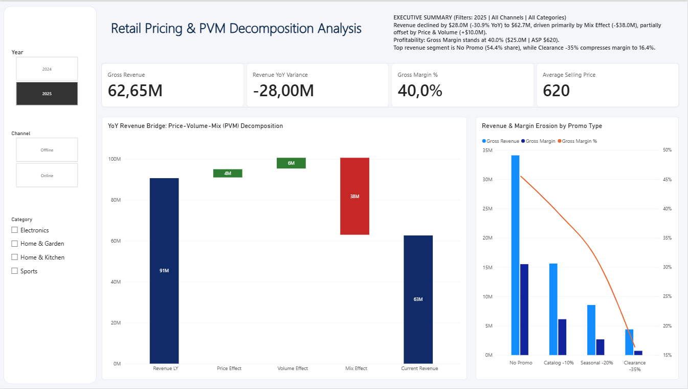

# Retail Pricing & Price-Volume-Mix (PVM) Decomposition Analysis

An end-to-end Retail Revenue Management & Pricing Analytics solution built with **Python (DuckDB ETL)** and **Power BI (Star Schema & DAX)**. The project isolates the exact financial drivers behind Year-over-Year (YoY) revenue variance—separating true **Price**, **Volume**, and **Product Mix** effects—while quantifying promotional margin erosion across retail channels and categories.



---

## Business Problem & Objectives

In multi-category retail, headline revenue growth or contraction often masks underlying pricing and margin risks. A drop in top-line revenue might stem from falling unit demand, aggressive discounting, or a structural shift toward lower-priced product tiers.

This solution answers four core commercial questions:
1. **YoY Revenue Bridge (PVM Decomposition):** How much of the YoY revenue change (`-$28.0M` / `-30.9%` in 2025) was driven by unit price adjustments (**Price Effect**), unit demand shifts (**Volume Effect**), or changes in category sales composition (**Mix Effect**)?
2. **Promotional Margin Erosion:** How severely do tiered promotional campaigns (`Catalog -10%`, `Seasonal -20%`, `Clearance -35%`) compress Gross Margin % compared to full-price baseline sales (`No Promo`)?
3. **Channel & Category Dynamics:** How do Average Selling Price (ASP) and profitability behave across `Online` vs. `Offline` channels and product categories (`Electronics`, `Home & Garden`, `Home & Kitchen`, `Sports`)?
4. **Automated Executive Reporting:** Can dynamic DAX measures synthesize filter-aware, executive-ready takeaways in real time without manual commentary?

---

## Key Analytical Insights (2025 Full-Year View)

* **Dominant Negative Mix Effect (`-$38.0M`):** Despite positive contributions from **Price (`+$4.0M`)** and **Volume (`+$6.0M`)**, overall Gross Revenue contracted by **`-$28.0M` (`-30.9% YoY`)** to **`$62.7M`** due to a sharp portfolio shift away from high-ticket Electronics toward lower-ASP everyday categories.
* **Promotional Margin Compression:** Full-price sales (`No Promo`) generate **`54.4%`** of total revenue while maintaining a healthy Gross Margin above **`45%`**. Conversely, deep **`Clearance -35%`** events erode Gross Margin down to **`16.4%`**, dragging blended company margin to **`40.0%`** (`$25.0M` Gross Profit at `$620.19` ASP).

---

## Architecture & Tech Stack

### 1. Synthetic Data Engineering & DuckDB ETL (`src/`)
* **`01_generate_retail_data.py`**: Generates ~172,500 realistic multi-year retail transactions (`2023–2025`) with progressive price inflation, seasonal demand curves, channel-specific discounting, and controlled category mix shifts into `data_raw/`.
* **`02_transform_pricing_etl.py`**: Processes raw transaction logs via **DuckDB**, validates referential integrity, calculates unit costs/net revenues, and outputs a normalized **Star Schema** into `data_clean/` ready for Power BI ingestion.

### 2. Data Model (Star Schema)
* **Fact Table:** `FACT_Sales` (transaction-level quantities, list prices, realized unit prices, discounts, promo type, COGS, and gross revenue).
* **Dimension Tables:** `DIM_Product` (SKU, category, brand, price tier), `DIM_Store` (channel: Online/Offline, region) and a dedicated `DIM_Calendar` table supporting time-intelligence calculations.

### 3. Advanced DAX Engineering
* **Price-Volume-Mix (PVM) Bridge Logic:**

$$\text{Price Effect} = \sum (P_{\text{CY}} - P_{\text{LY}}) \times Q_{\text{CY}}$$

$$\text{Volume Effect} = (Q_{\text{CY, Total}} - Q_{\text{LY, Total}}) \times \text{ASP}_{\text{LY, Total}}$$

$$\text{Mix Effect} = \Delta \text{Revenue}_{\text{YoY}} - (\text{Price Effect} + \text{Volume Effect})$$
* **Dynamic Executive Narrative (`Executive_Narrative`):** A locale-safe DAX measure utilizing `TOPN`, `ADDCOLUMNS`, and `SWITCH` to dynamically evaluate active slicer contexts, identify the primary PVM variance driver, detect the highest-revenue and lowest-margin promo tiers on the fly, and format scales (`$M` / `$K`) automatically.

---

## Repository Structure

```text
├── assets/
│   └── dashboard_overview.png      # High-resolution Power BI dashboard preview
├── data_clean/                     # Clean Star Schema tables (fact & dimensions)
├── data_raw/                       # Raw generated transaction & master files
├── src/
│   ├── 01_generate_retail_data.py  # Multi-year retail dataset generator
│   └── 02_transform_pricing_etl.py # DuckDB ETL pipeline & Star Schema builder
├── .gitignore
├── requirements.txt
└── README.md
